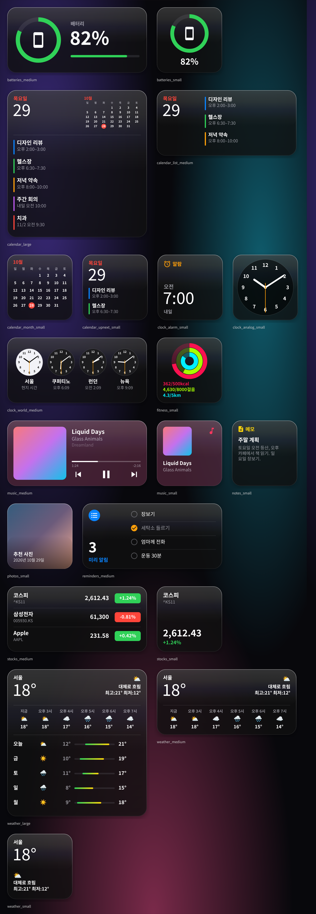

# iOS 기본 앱 위젯 → KWGT (다크 모드 · Liquid Glass)

iOS 26 기본 앱 위젯을 KWGT로 옮긴 프리셋 모음입니다. 모두 다크 모드,
Liquid Glass 스타일로 만들었습니다.



## 설치

1. `dist/*.kwgt` 파일을 폰의 `Kustom/widgets/` 폴더에 복사합니다.
2. 홈 화면에 KWGT 위젯을 추가합니다. 크기는 스몰 2×2, 미디엄 4×2,
   라지 4×4입니다. 위젯을 탭한 뒤 **프리셋 불러오기 → SD 카드**를
   선택합니다.
3. 크기는 루트 레이어가 셀 크기에 맞춰 자동으로 조절합니다
   (`config_scale_value` 수식).
4. 날씨, 일정, 음악 위젯을 쓰려면 KWGT에 위치, 캘린더, 알림 접근
   권한을 허용해야 합니다.

## 위젯 목록

| iOS 앱 | 파일 | 데이터 소스 |
|---|---|---|
| 시계 – 아날로그 | `clock_analog_small` | 시스템 시계 (초침 포함) |
| 시계 – 세계 시계 | `clock_world_medium` | 시차 전역 변수 `o1..o4`, 도시 이름 `c1..c4`. 낮이면 흰 시계판, 밤이면 검은 시계판 |
| 시계 – 알람 | `clock_alarm_small` | `si(alarmd)` 다음 알람 |
| 캘린더 – 다음 일정 | `calendar_upnext_small` | `ci()` 다음 일정 2개 |
| 캘린더 – 월간 | `calendar_month_small` | 일요일부터 시작하는 달력, 오늘 날짜 빨간 원 |
| 캘린더 – 목록 | `calendar_list_medium` | 일정 3개 |
| 캘린더 – 라지 | `calendar_large` | 날짜 + 미니 달력 + 일정 5개 |
| 날씨 | `weather_small/medium/large` | `wi()/wf()`: 현재 날씨, 시간별 예보 6개, 5일 예보와 온도 범위 막대 |
| 배터리 | `batteries_small/medium` | `bi(level)`, `bi(charging)`: 20% 이하면 빨간색, 충전 중이면 아이콘 바뀜 |
| 음악 / 팟캐스트 | `music_small/medium` | `mi()`: 앨범 아트, 앨범 아트 주조색 틴트, 진행 바, 이전·재생·다음 버튼 |
| 피트니스 | `fitness_small` | `fd(cals/steps/dista)`: 링 3개. 목표는 전역 변수 `g1..g3` |
| 주식 | `stocks_small/medium` | Yahoo Finance 시세. 심볼은 전역 변수 `s1..`, 이름은 `n1..` |
| 미리 알림 | `reminders_medium` | 전역 변수에 입력한 할 일 4개, 탭하면 완료 체크 |
| 메모 | `notes_small` | 전역 변수 `t`(제목), `b`(내용) |
| 사진 | `photos_small` | 편집기에서 `Photo` 모듈 → FX → 비트맵으로 사진 지정 |

탭하면 시계·캘린더 위젯은 Google 시계/캘린더 앱을 엽니다. 삼성 기기라면
편집기의 터치 액션에서 앱을 바꿔 주세요. 음악 위젯은 재생 중인 앱을 열고,
날씨 위젯은 날씨를 새로 고칩니다.

## Liquid Glass 구현 방식

안드로이드 위젯은 뒤에 있는 배경화면을 블러 처리할 수 없습니다. 그래서
유리 느낌은 다음 네 겹으로 표현했습니다.

1. 반투명 어두운 본체: `#9E1C1C1E`에서 `#B80B0B0D`로 내려가는 세로
   그라디언트, 아래쪽 그림자 포함
2. 상단 광택: 위쪽 55% 영역에 흰색 12%에서 0%로 흐려지는 그라디언트
3. 림 라이트: 2px 테두리, 흰색 45%에서 8%로 흐려짐
4. 음악 위젯 전용: 앨범 아트 주조색 30% 틴트

색상은 iOS 다크 모드 시스템 컬러를 썼습니다(라벨 60%, 빨강 `#FF453A`
등). 글꼴은 기기 기본 글꼴을 씁니다. 한글이 섞이면 Inter 같은 글꼴은
라틴 문자와 한글 모양이 어긋나기 때문입니다.

## 할 수 없는 것

KWGT에서 데이터에 접근할 수 없어 만들지 않은 위젯입니다: 스크린 타임,
나의 찾기, 홈, 지갑, 지도, 파일, 단축어, 스마트 스택, 뉴스, Safari,
연락처, 잠금 화면 위젯.

미리 알림과 메모는 iOS 데이터를 읽을 수 없어서, KWGT 전역 변수에 직접
입력하는 방식으로 대신했습니다.

## 실기기에서 확인할 점

미리보기는 샘플 값으로 그린 것입니다. 아래 함수는 문서를 직접 확인하지
못해 기억에 의존해 작성했으니, 처음 불러올 때 값이 제대로 나오는지
확인해 주세요. 값이 이상하면 편집기에서 해당 수식만 고치면 됩니다.

- 시간별 예보 인덱스 `wf(temp, 1h)`
- 요일 번호 `df(f)`: 월요일이 1이라고 가정했습니다 (월간 달력 시작 칸 계산)
- `ai(isday)`(낮/밤 아이콘), 정규식 비교 연산자 `~=`
- 피트니스 `fd(cals|steps|dista)`: 기기의 Health Connect 연동 상태에 따라 다릅니다
- 세계 시계 시차는 고정값입니다. 서머타임이 바뀌면 1시간씩 직접
  조정해야 합니다. 예: 쿠퍼티노는 11월 1일 이후 -16에서 -17로.
- Yahoo Finance 응답이 막히면 주식 위젯 값이 비어 보일 수 있습니다

## 다시 빌드하기

```sh
python3 kwgt/build.py                 # dist/*.kwgt, previews/*.svg 생성
node kwgt/render_previews.mjs         # 썸네일 JPG + gallery.png 생성 후 재패키징
```

모든 위젯은 `build.py`의 `w_*` 함수 하나씩으로 정의되어 있습니다. 같은
정의로 KWGT JSON과 SVG 미리보기를 함께 만듭니다.
